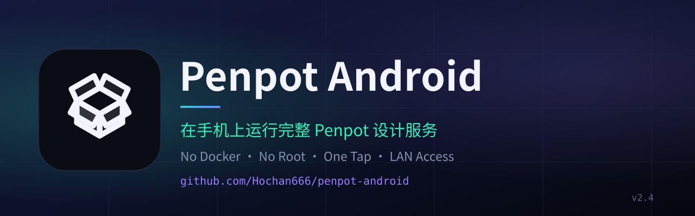
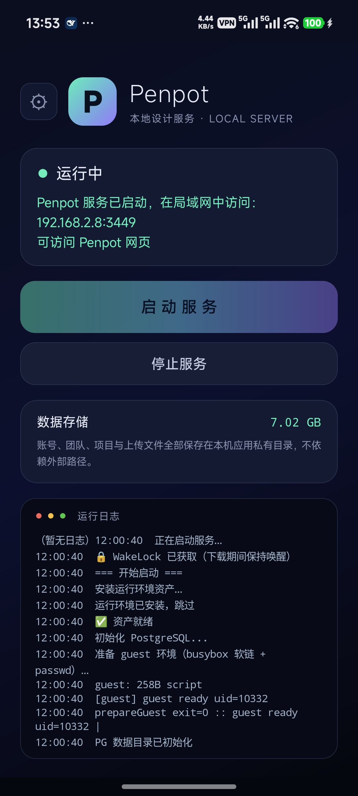
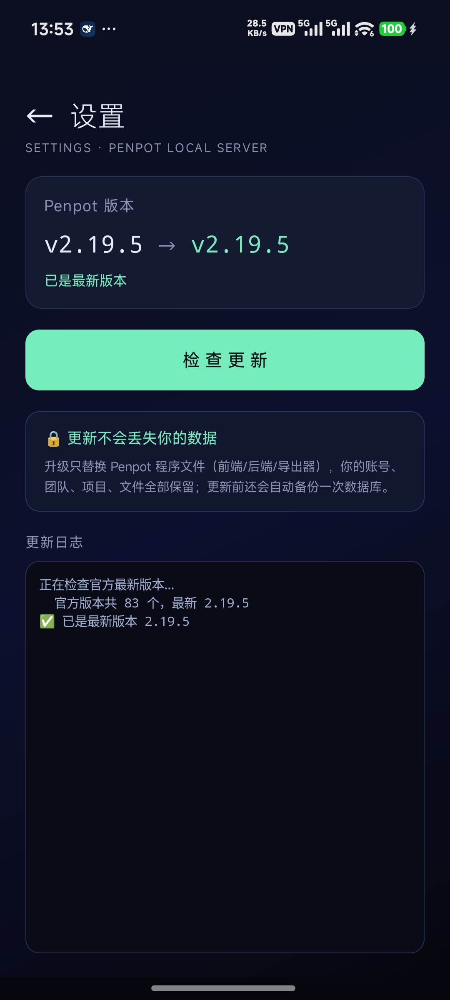
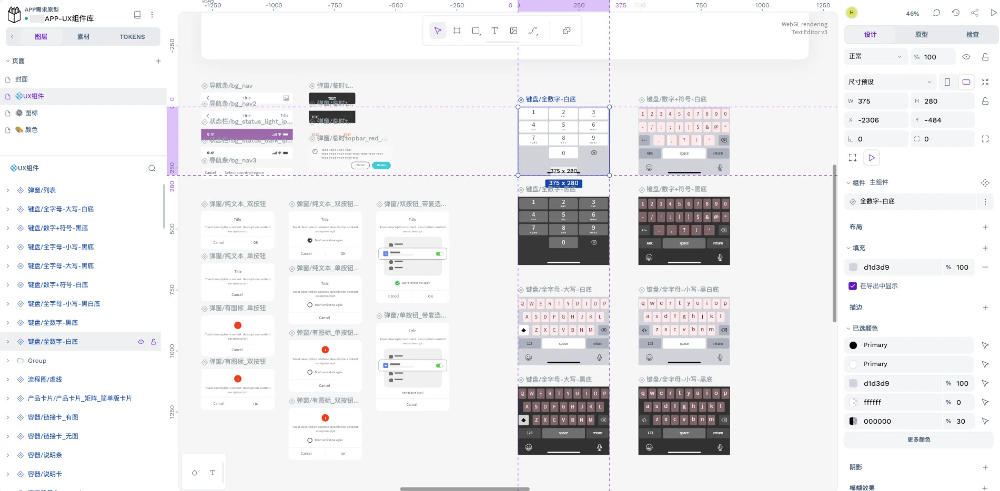

# 📦 Penpot Android — 把Figma的平替工具【Penpot】装进你的手机

<p align="center">
  
</p>

<p align="center">
  
  
  
  
  
  
</p>

**在 Android 手机上直接运行完整的 Penpot 设计服务，局域网一键访问。无需 PC、无需服务器、无需 Docker。**

> 它是一个「运行环境容器」：装好 App、点一下按钮，它会自己把 PostgreSQL、Valkey、Penpot 前端 / 后端 / 导出器全部拉齐并跑起来。

<p align="center">
  <a href="https://github.com/Hochan666/penpot-android/releases/latest">
    
  </a>
</p>

<a href="#cn">**中文**</a> · <a href="#en">**English**</a> · <a href="#install">**📥 下载安装**</a> · <a href="#faq">**❓ FAQ**</a>

---

<p align="center">
  
  
</p>

<p align="center"><sub>← 主界面（运行中，自动显示局域网地址） &nbsp;&nbsp;&nbsp; 设置页（检查更新 / 下载并更新） →</sub></p>

<p align="center">
  
</p>

<p align="center"><sub>↑ 同一局域网内的电脑 / 平板浏览器直接打开 <code>http://&lt;手机IP&gt;:3449</code>，就是完整的 Penpot 网页版</sub></p>

---

<a id="cn"></a>

## 🌐 中文

### 这是什么

**Penpot Android** 是一个把 [Penpot](https://penpot.app)（开源设计与原型工具，Figma 的开源替代品）完整搬到 Android 手机上的**运行环境容器 App**。

Penpot 官方只提供 Docker Compose / Kubernetes / Helm 三种部署方式，全都要求 Linux 服务器 + Docker。这个项目换了一条路：**用 Android App 自己的进程，直接以用户态方式运行整套 Penpot 组件**，不需要 root、不需要 Docker、不需要任何外部服务。

装好 APK → 点「启动服务」→ 手机屏幕上出现一个局域网地址 → 同一 Wi-Fi 下的任何设备（电脑 / 平板 / 另一台手机）用浏览器打开就能用 Penpot 网页版。

### ✨ 核心特性

| 特性 | 说明 |
|---|---|
| 🚀 **一键启动** | 主界面一个大按钮，点下去自动完成环境初始化、数据库启动、五个组件拉起 |
| 📡 **局域网直连** | 运行时自动探测本机 IP，界面直接显示 `192.168.x.x:3449` 这样的可访问地址 |
| 🔄 **内置版本更新** | 设置页「检查更新」直连官方 Docker Registry 查最新版本，一键下载并热切换，**不动用户数据** |
| 💾 **数据全本地** | 账号、团队、项目、上传的图片字体全部存在手机应用私有目录，不上传任何云端 |
| 🎨 **深色科技风 UI** | 状态仪表盘、渐变按钮、实时终端日志、数据占用实时统计 |
| 🔒 **更新不丢数据** | 升级前自动备份数据库，新旧版本目录并存可回滚，更新完自动恢复服务 |
| 📦 **零外部依赖** | APK 自带精简 Linux 运行环境，无需 Termux / root / Docker |

### 🧠 它是怎么实现的（技术说明）

这是本项目最有意思的部分——**在没有 Docker、没有 root、只有普通 App 权限的 Android 上跑一整套 Linux 服务**。

#### 1. 用户态 Linux 运行环境

APK 内置了一个静态编译的 ELF 装载器（`dsh_alpine`，43 KB）+ 一套精简 Alpine Linux 根文件系统。装载器以普通 App 进程的身份，把 Alpine 的 `musl` 用户态直接映射进进程空间运行——**不需要 chroot，不需要 root**。

#### 2. 五个组件，三种运行时

| 组件 | 运行时 | 端口 | 作用 |
|---|---|---|---|
| PostgreSQL 17 | musl（Alpine） | 5432 | 存储账号 / 团队 / 项目 / 画板数据 |
| Valkey | musl（Alpine） | 6379 | Redis 兼容缓存与消息通道 |
| Penpot Backend | glibc（Debian）+ JVM | 6060 | Clojure 业务逻辑与 RPC |
| Penpot Frontend | glibc（Debian）+ nginx | 3449 | **对外网页入口**，反向代理 `/api` 与 WebSocket |
| Penpot Exporter | glibc + Chromium | 6061 | 导出 PNG / PDF / SVG（服务端渲染） |

#### 3. 绕过三项 Android 平台限制

Android 的 seccomp 沙箱会拦掉三个 Linux 服务端程序必需的系统调用，项目用三个 `LD_PRELOAD` 垫片（shim）解决：

| 限制 | 现象 | 解决办法 |
|---|---|---|
| `accept()` 被禁 | nginx / JVM 无法监听端口 | `libacceptshim.so` 把 `accept()` 重定向到允许的 `accept4(..., SOCK_CLOEXEC)` |
| SysV IPC 被禁 | PostgreSQL 无法创建共享内存段 | `libsysv.so` 用 POSIX `shm_open` + `mmap` + 文件模拟 `shmget/shmat/shmctl` 与信号量 |
| `SIGSYS` 处理器被覆盖 | 进程启动即 `SIGBUS` | `libsig.so` 拦截 `sigaction()`，保住装载器预装的兼容处理器 |

再加上 PostgreSQL 配置层面的 `shared_memory_type=mmap`、`dynamic_shared_memory_type=posix`，整套服务就活了。

#### 4. JVM 与 Chromium 的额外处理

- **Backend**：用 `-Djdk.lang.Process.launchMechanism=FORK` 让 JVM 用 `fork` 而非 `posix_spawn` 创建子进程（`posix_spawn` 在这套环境里不可用）。
- **Exporter**：Chromium 以 `--single-process` 模式运行，并配置 `internal-uri` 指向前端 3449。

#### 5. 镜像下载与解压

Penpot 官方只发布 Docker 镜像。App 内置了一个完整的 **OCI Registry 客户端**：

- 匿名 token 鉴权 → 拉取 `manifest` → 按 arm64 平台选出 16~59 个镜像层
- 每层 2 MB 分块、8 线程并发、HTTP Range 断点续传、`sha256` 逐层校验
- zstd（exec）/ gzip（JDK 内置）双解压路径
- 手写 tar 解析器（支持 PAX 扩展头、GNU 长文件名、符号链接、硬链接退化）

硬链接在 Android 上被禁止（`link()` 不允许），解析器会把它退化成文件复制。

#### 6. 更新机制（数据零丢失）

「下载并更新」执行六步：

```
① 下载新版镜像到 staging 目录 apps_next（不影响运行中的旧版）
② 停止服务（保证数据库一致）
③ 自动备份 PostgreSQL 数据目录 → files/backups/pg_<版本>_<时间>.tar.zst
④ 原子切换：apps → apps_prev，apps_next → apps
⑤ 写版本标记
⑥ 重新启动服务
```

数据库目录 `base/var/lib/postgresql/data` **从头到尾没被碰过**，所以账号、团队、项目、文件全部原地保留。旧版本目录留着可回滚，数据库备份保留最近 3 份。

### 🆚 相比手动部署到 PC / 服务器的优势

| 对比项 | 手动部署（官方 Docker 方式） | **Penpot Android** |
|---|---|---|
| 硬件成本 | 需要一台常开的 PC 或云服务器 | 用你正在用的手机，零额外成本 |
| 部署步骤 | 装 Docker → 写 `docker-compose.yml` → 拉 2 GB 镜像 → 调环境变量 → 处理端口/证书 | 装 APK → 点「启动服务」 |
| 技术门槛 | 需要 Linux / Docker / 网络 / 反向代理知识 | 零门槛，按钮式操作 |
| 开机自启 / 保活 | 自己配 systemd / supervisor | 前台服务 + WakeLock + 看门狗，App 管好 |
| 版本更新 | `docker compose pull` + 手动处理数据迁移 | 设置页点两下，自动备份 + 原子切换 |
| 耗电与占用 | 一台 PC 常年 50~200 W | 手机闲置时几乎零开销，用完点「停止服务」 |
| 局域网访问 | 配端口映射 / 防火墙 / 局域网 DNS | 界面直接告诉你 `192.168.x.x:3449` |
| 数据归属 | 在服务器上，需要自己备份 | 在手机私有目录，更新自动备份 |

**一句话**：把"搭一套自建设计平台"从**运维任务**降级成**点一个按钮**。

### 📱 功能一览

**主界面**
- 状态指示（已停止 / 启动中 / 运行中 / 停止中 / 启动失败）
- 【启动服务】渐变按钮 / 【停止服务】按钮
- 运行中自动显示局域网访问地址（IP 运行时动态探测，换 Wi-Fi 自动更新）
- 数据存储占用实时统计
- 实时滚动终端日志（完整启动过程可见）

**设置页（左上角 ⚙）**
- 当前 Penpot 版本 & 官方最新版本
- 【检查更新】→ 直连 Docker Hub 查询 tag 列表
- 发现新版 → 出现【下载并更新】按钮 → 二次确认（写明下载量 / 停机时间 / 数据保留承诺）→ 全自动执行
- 数据安全说明 & 更新日志

<a id="install"></a>

### 📥 下载与安装 / Download & Install

**下载**：从本仓库 [Releases](https://github.com/Hochan666/penpot-android/releases) 页面下载 `Penpot-Android-v2.4.apk`（约 22 MB）。

**安装**
1. 手机上点开 APK → 允许「安装未知来源应用」
2. 安装完成后打开 App
3. 点【启动服务】，**首次启动会自动下载约 2.1 GB** 的 Penpot 运行镜像（需要 Wi-Fi，耗时视网速 5~20 分钟）
4. 状态变为「● 运行中」并显示局域网地址（如 `192.168.2.8:3449`）
5. 同一 Wi-Fi 下，电脑或平板浏览器打开该地址 → 完成 🎉

**注册账号**：首次打开网页版，点「现在还没有账号？创建账号」，用任意邮箱注册即可（默认关闭邮件验证，无需收信）。

### ⚙️ 系统要求 / Requirements

| 项目 | 要求 |
|---|---|
| 系统版本 | Android 7.0（API 24）及以上 |
| CPU 架构 | **arm64-v8a**（arm64 设备） |
| 存储空间 | **首次安装约需 3 GB 可用空间**（APK 22 MB + 运行环境约 74 MB + Penpot 镜像约 2.1 GB + 更新时额外需 2.1 GB 暂存） |
| 运行内存 | **建议 4 GB 及以上**（实测峰值约 2.2 GB：JVM 1.5 GB + PostgreSQL 128 MB + nginx/node 若干） |
| 网络 | 首次需联网下载镜像；之后可在纯局域网离线运行 |
| root / Docker | **完全不需要** |

**实测环境**：Android 15 / arm64 / 8 核 / 15 GB RAM / 480 GB 存储 —— 五个组件全部正常运行，导出功能可用。

> ⚠️ 首次下载约 2.1 GB，更新时暂存又需 2.1 GB。**请确保至少 3 GB 空闲存储**。App 内的「数据存储」卡片会实时显示当前占用。

### 📖 使用说明

1. **启动**：点【启动服务】。首次会下载镜像；之后启动约 45~60 秒（启动 PostgreSQL → 建库 → Valkey → Backend → Frontend → Exporter）。
2. **访问**：界面提示的地址（如 `http://192.168.2.8:3449`）在**同一局域网**内的任何设备浏览器打开。
3. **停止**：点【停止服务】，五个组件进程全部结束、端口全部释放，界面回到「已停止」。
4. **更新**：设置页 →【检查更新】→ 有新版则【下载并更新】。更新期间服务会停 1~3 分钟，数据自动备份、全部保留。
5. **换 Wi-Fi**：IP 会自动重新探测，提示文案自动更新，无需重设。
6. **数据在哪**：全部在 App 私有目录（`/data/data/com.penpot.android/files/`），主界面「数据存储」卡片显示总占用。

### ⚠️ 已知限制

- **仅 arm64-v8a**：未打包 armeabi-v7a / x86_64。旧款 32 位手机无法使用。
- **需要保持前台服务**：系统若强行清理后台（部分国产 ROM 的省电策略），服务会中断。建议在使用期间把本 App 加入电池优化白名单。
- **端口固定**：PostgreSQL 5432 / Valkey 6379 / Backend 6060 / Frontend 3449 / Exporter 6061。若手机上有其他程序占用这些端口会冲突。
- **首次联网下载**：镜像来自 Docker Hub，国内网络可能较慢（已内置断点续传与重试）。
- **无 HTTPS**：局域网明文 HTTP，请仅在可信网络使用（不要在公共 Wi-Fi 暴露）。
- **单机使用**：定位是"个人 / 小团队局域网自建"，不是公网多租户服务。

### 📄 开源声明 / License & Terms

```
本项目（Penpot Android）采用自定义许可协议发布：

✅ 允许：免费使用、学习、修改、二次开发、个人或团队内部部署
❌ 禁止：任何形式的商业用途（包括但不限于售卖、租用、SaaS 打包出售、
        作为商业产品的一部分分发、提供付费代部署服务）

📌 转载或二次开发必须以显著方式声明来源于本项目，并附上本仓库链接。
📌 二次开发的衍生作品须沿用同样的"禁止商用 + 署名"条款。

Penpot 本身是 Kaleidos 公司的开源项目，采用 MPL-2.0 许可证。
本仓库仅包含 Android 运行环境外壳与部署脚本，不包含 Penpot 源代码本身；
Penpot 的镜像由 App 在运行时从官方 Docker Registry 下载。
Penpot 及其 Logo 为 Kaleidos 的商标，本项目与其无隶属关系。
```

完整条款见 [LICENSE](LICENSE)。

### 🙏 致谢

- [Penpot](https://penpot.app) — 伟大的开源设计工具
- [Kaleidos](https://kaleidos.net) — Penpot 背后的团队
- Alpine Linux、PostgreSQL、Valkey、nginx、Eclipse Temurin JRE

<p align="right"><a href="#en">🇬🇧 Read in English ↓</a></p>

---

<a id="en"></a>

## 🌐 English

### What is this

**Penpot Android** is a **runtime-container app** that brings [Penpot](https://penpot.app) — the open-source design & prototyping tool, a self-hostable alternative to Figma — onto an Android phone.

Penpot officially ships only as Docker Compose / Kubernetes / Helm, all requiring a Linux server with Docker. This project takes a different route: **it runs the entire Penpot stack in user space inside a plain Android app process** — no root, no Docker, no external services.

Install the APK → tap **Start Service** → the app shows a LAN address → open it from any browser on the same Wi-Fi.

### ✨ Highlights

| Feature | Description |
|---|---|
| 🚀 **One-tap start** | A single button boots the environment, database and all five components |
| 📡 **LAN address auto-detected** | The local IP is resolved at runtime and shown right on screen |
| 🔄 **Built-in updater** | Queries the official Docker Registry, downloads and hot-swaps the new version **without touching your data** |
| 💾 **Local-first data** | Accounts, teams, projects and uploaded assets stay in the app's private storage |
| 🎨 **Dark, technical UI** | Status dashboard, gradient buttons, live terminal log, live storage usage |
| 🔒 **Lossless updates** | Automatic DB backup before upgrade, old version kept for rollback, service auto-restart |
| 📦 **Zero external deps** | Ships its own minimal Linux runtime — no Termux, no root, no Docker |

### 🧠 How it works

The interesting part: **running a full Linux server stack on Android without Docker and without root.**

#### 1. User-space Linux runtime

The APK bundles a statically-linked ELF loader (`dsh_alpine`, 43 KB) plus a trimmed Alpine Linux root filesystem. The loader maps Alpine's `musl` user space directly into the app process — **no chroot, no root required**.

#### 2. Five components, three runtimes

| Component | Runtime | Port | Role |
|---|---|---|---|
| PostgreSQL 17 | musl (Alpine) | 5432 | Accounts / teams / projects / boards |
| Valkey | musl (Alpine) | 6379 | Redis-compatible cache & pub/sub |
| Penpot Backend | glibc (Debian) + JVM | 6060 | Clojure business logic & RPC |
| Penpot Frontend | glibc (Debian) + nginx | 3449 | **Public web entry**, reverse-proxies `/api` & WebSocket |
| Penpot Exporter | glibc + Chromium | 6061 | PNG / PDF / SVG export (server-side render) |

#### 3. Working around three Android platform restrictions

Android's seccomp sandbox blocks three syscalls that server software needs. Three `LD_PRELOAD` shims fix it:

| Restriction | Symptom | Fix |
|---|---|---|
| `accept()` blocked | nginx / JVM cannot listen | `libacceptshim.so` redirects `accept()` to the permitted `accept4(..., SOCK_CLOEXEC)` |
| SysV IPC blocked | PostgreSQL cannot create shared memory | `libsysv.so` emulates `shmget/shmat/shmctl` + semaphores via POSIX `shm_open` / `mmap` / files |
| `SIGSYS` handler overridden | Process dies with `SIGBUS` at startup | `libsig.so` intercepts `sigaction()` to preserve the loader-installed compat handler |

Plus PostgreSQL config `shared_memory_type=mmap` and `dynamic_shared_memory_type=posix`.

#### 4. JVM & Chromium specifics

- **Backend**: `-Djdk.lang.Process.launchMechanism=FORK` makes the JVM use `fork` instead of `posix_spawn`.
- **Exporter**: Chromium runs with `--single-process`, `internal-uri` pointed at frontend 3449.

#### 5. Image download & extraction

Penpot is distributed only as Docker images. The app embeds a full **OCI Registry client**:

- Anonymous token auth → fetch `manifest` → select arm64 layers (16–59 layers)
- 2 MB chunks, 8 concurrent threads, HTTP Range resume, per-layer `sha256` verification
- Dual decompression: zstd (exec) / gzip (JDK built-in)
- Hand-written tar parser (PAX extended headers, GNU long names, symlinks, hardlink fallback)

Hard links are forbidden on Android (`link()` denied), so the parser degrades them to file copies.

#### 6. Lossless update flow

```
① Download new image layers into staging dir apps_next (old version keeps running)
② Stop services (database consistency)
③ Auto-backup PostgreSQL data dir → files/backups/pg_<ver>_<ts>.tar.zst
④ Atomic swap: apps → apps_prev, apps_next → apps
⑤ Write version marker
⑥ Restart services
```

The data directory `base/var/lib/postgresql/data` is **never touched**, so accounts, teams, projects and files survive intact. The previous version stays available for rollback; the last 3 DB backups are retained.

### 🆚 Versus manual deployment on a PC / server

| Aspect | Manual (official Docker) | **Penpot Android** |
|---|---|---|
| Hardware cost | A dedicated PC or cloud VM | The phone you already own |
| Setup steps | Install Docker → write compose file → pull 2 GB → tune env → ports/TLS | Install APK → tap Start |
| Skill needed | Linux / Docker / networking / reverse proxy | None |
| Persistence | Configure systemd / supervisor yourself | Foreground service + WakeLock + watchdog |
| Upgrading | `docker compose pull` + manual data migration | Two taps, auto-backup + atomic swap |
| Power draw | A PC idling at 50–200 W | Negligible; tap Stop when done |
| LAN access | Port mapping / firewall / local DNS | The app just shows you `192.168.x.x:3449` |
| Data ownership | On the server, you handle backups | In app-private storage, auto-backed-up on update |

**In one line:** it downgrades "stand up a self-hosted design platform" from an *ops task* to *one button*.

### 📱 Features

**Home**
- Status indicator (stopped / starting / running / stopping / failed)
- **Start Service** gradient button / **Stop Service** button
- Live LAN address (IP probed at runtime, updates when Wi-Fi changes)
- Live storage usage
- Live scrolling terminal log of the whole boot sequence

**Settings (⚙ top-left)**
- Current & latest official Penpot version
- **Check for updates** → queries Docker Hub tag list
- New version found → **Download & Update** button → confirmation dialog (download size / downtime / data-retention promise) → fully automatic
- Data-safety note & update log

### 📥 Download & Install

**Download**: grab `Penpot-Android-v2.4.apk` (~22 MB) from this repo's [Releases](https://github.com/Hochan666/penpot-android/releases) page.

**Install**
1. Open the APK on your phone → allow "install from unknown sources"
2. Launch the app
3. Tap **Start Service** — the first run **downloads ~2.1 GB** of Penpot images (use Wi-Fi; 5–20 min depending on speed)
4. Status turns **● Running** and a LAN address appears (e.g. `192.168.2.8:3449`)
5. On any device on the same Wi-Fi, open that address in a browser → done 🎉

**Create an account**: on the web UI, click "Don't have an account yet? Create account" and register with any email (email verification is disabled by default).

### ⚙️ Requirements

| Item | Requirement |
|---|---|
| OS | Android 7.0 (API 24) or newer |
| CPU ABI | **arm64-v8a** only |
| Storage | **~3 GB free recommended** (APK 22 MB + runtime ~74 MB + images ~2.1 GB + 2.1 GB staging during updates) |
| RAM | **4 GB+ recommended** (observed peak ≈ 2.2 GB: JVM 1.5 GB + PostgreSQL 128 MB + nginx/node) |
| Network | Internet needed on first run; afterwards works offline on a LAN |
| root / Docker | **Not required at all** |

**Tested on**: Android 15 / arm64 / 8-core / 15 GB RAM / 480 GB storage — all five components running, export working.

> ⚠️ First download ≈ 2.1 GB, plus another 2.1 GB of staging during updates. **Keep at least 3 GB free.** The "Data Storage" card shows live usage.

### 📖 Usage

1. **Start**: tap **Start Service**. First run downloads images; later boots take ~45–60 s (PostgreSQL → create DB → Valkey → Backend → Frontend → Exporter).
2. **Access**: open the shown address (e.g. `http://192.168.2.8:3449`) from any device **on the same LAN**.
3. **Stop**: tap **Stop Service** — all five processes end, all ports are released, UI returns to "Stopped".
4. **Update**: Settings → **Check for updates** → **Download & Update**. Service stops for 1–3 min; data is backed up and fully preserved.
5. **Switch Wi-Fi**: IP is re-probed automatically, no reconfiguration needed.
6. **Where's my data**: entirely in app-private storage (`/data/data/com.penpot.android/files/`); the home screen's "Data Storage" card shows total usage.

### ⚠️ Known limitations

- **arm64-v8a only** — no armeabi-v7a / x86_64 build. Older 32-bit phones won't work.
- **Needs the foreground service alive** — aggressive OEM battery managers may kill it. Whitelist the app during use.
- **Fixed ports** — PostgreSQL 5432 / Valkey 6379 / Backend 6060 / Frontend 3449 / Exporter 6061. Conflicts if another app holds them.
- **First-run download from Docker Hub** — may be slow in some regions (resume + retries built in).
- **No HTTPS** — plain HTTP on your LAN. Use only on trusted networks.
- **Single-machine scope** — meant for personal / small-team LAN self-hosting, not public multi-tenant service.

### 📄 License & Terms

```
This project (Penpot Android) is released under a custom license:

✅ Permitted: free use, study, modification, derivative work,
   personal or internal team deployment
❌ Prohibited: any commercial use — including selling, renting,
   packaging as SaaS, bundling into a commercial product,
   or offering paid deployment services

📌 Redistribution or derivative work MUST visibly credit this project
   and link back to this repository.
📌 Derivative works must carry the same "no commercial use + attribution" terms.

Penpot itself is an open-source project by Kaleidos, licensed under MPL-2.0.
This repository contains only the Android runtime shell and deployment scripts,
not Penpot's source code; Penpot images are downloaded from the official
Docker Registry at runtime.
Penpot and its logo are trademarks of Kaleidos. This project is not affiliated with them.
```

See [LICENSE](LICENSE) for the full text.

### 🙏 Credits

- [Penpot](https://penpot.app) — a great open-source design tool
- [Kaleidos](https://kaleidos.net) — the team behind Penpot
- Alpine Linux, PostgreSQL, Valkey, nginx, Eclipse Temurin JRE

<p align="right"><a href="#cn">🇨🇳 阅读中文版 ↑</a></p>

---

<a id="faq"></a>

## ❓ 常见问题 / FAQ

<details>
<summary><b>启动后网页打不开？</b> / The web page won't load after starting</summary>

1. 确认手机和访问设备在**同一个 Wi-Fi / 局域网**
2. 确认界面状态是「● 运行中」（不是「启动中」）
3. 确认地址端口是 `3449`（不是 6060 或 5432）
4. 部分路由器开启了「AP 隔离」，会阻止局域网设备互访 —— 在路由器设置里关闭它
5. 手机连的是移动数据而非 Wi-Fi 时，局域网内其他设备访问不到

</details>

<details>
<summary><b>首次下载很慢 / 卡住？</b> / First download is slow or stalls</summary>

镜像来自 Docker Hub（registry-1.docker.io），国内网络可能不稳定。下载器内置了 2 MB 分块 + 8 线程并发 + 断点续传 + 多层重试，**中途卡住不会丢进度** —— 退出重进、点一次启动会从断点继续。

</details>

<details>
<summary><b>更新会不会丢我的项目？</b> / Will updating lose my projects?</summary>

不会。更新只替换程序文件（`files/apps` 目录），数据库目录 `files/base/var/lib/postgresql/data` 完全不碰。更新前还会自动把数据库打包备份到 `files/backups/`，并保留旧版本目录 `apps_prev` 可回滚。

</details>

<details>
<summary><b>能同时装多个实例吗？</b> / Can I run multiple instances?</summary>

不能。端口是固定的（5432/6379/6060/3449/6061），一个设备只能跑一套。

</details>

<details>
<summary><b>停止服务后就彻底不耗电了吗？</b> / Does stopping save all battery?</summary>

停止会结束全部五个进程并释放端口，之后 App 只剩一个空壳进程，几乎零开销。但为了下次快速启动，建议直接退出 App（从最近任务移除）。

</details>

<details>
<summary><b>为什么只有 arm64？</b> / Why arm64 only?</summary>

Penpot 的官方镜像本身就是 arm64/amd64 双架构，没有 32 位版本；而且整套服务内存需求（约 2.2 GB 峰值）也超出 32 位进程寻址能力。要支持 32 位需要重编所有组件，不在本项目范围内。

</details>

<details>
<summary><b>如何自行编译？</b> / How do I build it myself?</summary>

见 [BUILD.md](BUILD.md)。简要来说需要一个 Android SDK（aapt / d8 / apksigner / zipalign）+ JDK 17 + 一个静态 ELF 装载器和精简 Alpine rootfs 作为 asset。

</details>

---

<p align="center">
  <sub>Made with ☕ and a lot of strace on a phone.</sub><br/>
  <sub>本项目是一个独立的社区作品，与 Kaleidos / Penpot 官方无隶属关系。</sub>
</p>
